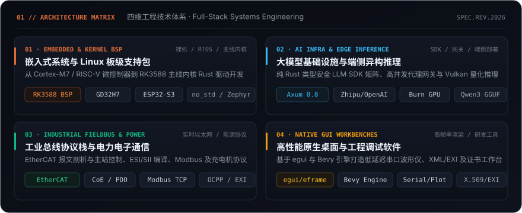
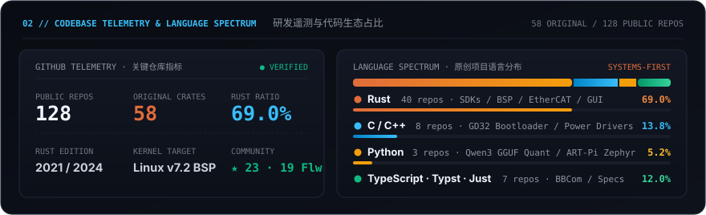
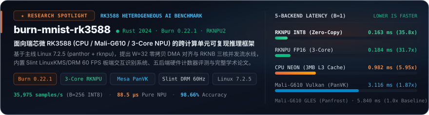
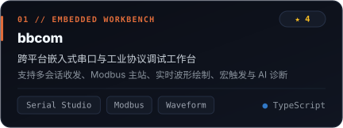
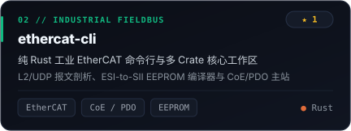
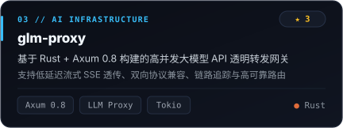
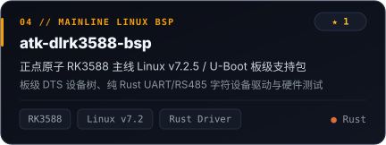
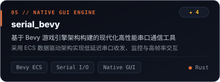
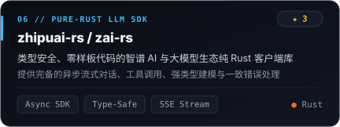

<div align="center">

<!-- ─── 00 // EXECUTIVE HERO BANNER ─── -->
<a href="https://github.com/AnlangA">
  
</a>

<br/>

<!-- ─── 01 // FOUR-PILLAR ARCHITECTURE MATRIX ─── -->


<br/>

<!-- ─── 02 // CODEBASE TELEMETRY & LANGUAGE SPECTRUM ─── -->


<br/>

<!-- ─── 03 // FLAGSHIP ENGINEERING WORKS ─── -->


<!-- Research & Engineering Spotlight: burn-mnist-rk3588 -->
<p align="center">
  <a href="https://github.com/AnlangA/burn-mnist-rk3588">
    
  </a>
</p>

<p align="center">
  <a href="https://github.com/AnlangA/bbcom">
    
  </a>
  <a href="https://github.com/AnlangA/ethercat-cli">
    
  </a>
</p>

<p align="center">
  <a href="https://github.com/AnlangA/glm-proxy">
    
  </a>
  <a href="https://github.com/AnlangA/atk-dlrk3588-bsp">
    
  </a>
</p>

<p align="center">
  <a href="https://github.com/AnlangA/serial_bevy">
    
  </a>
  <a href="https://github.com/AnlangA/zhipuai-rs">
    
  </a>
</p>

</div>

---

### `04 // OPEN-SOURCE REPOSITORY MATRIX · 开源工程索引`

| 领域 · Domain | 核心项目 · Repository | 技术栈 · Stack | 工程定位与架构特性 · Engineering Specification |
| :--- | :--- | :--- | :--- |
| **Edge AI & BSP** | [**`burn-mnist-rk3588`**](https://github.com/AnlangA/burn-mnist-rk3588) | `Rust` · `Burn 0.22` · `RKNPU2` | **RK3588 异构计算（CPU / Mali-G610 / 3-Core NPU）五后端推理基准与零拷贝 DMA 框架（0.163 ms / 35,975 samples/s + Slint DRM 60FPS GUI）** |
| **Edge AI & BSP** | [**`atk-dlrk3588-bsp`**](https://github.com/AnlangA/atk-dlrk3588-bsp) | `Rust` · `Linux v7.2.5` | 正点原子 RK3588 主线内核 / U-Boot 板级支持包，含板级 DTS 与纯 Rust UART/RS485 字符设备驱动 |
| **Edge AI & BSP** | [**`qwen3-rk3588-colab`**](https://github.com/AnlangA/qwen3-rk3588-colab) | `Python` · `GGUF` · `Vulkan` | Qwen3-1.7B BF16 转 Q4_K_M GGUF 量化流水线与 RK3588 Vulkan GPU 端侧推理验证 |
| **Edge AI & BSP** | [**`gd32h759boot`**](https://github.com/AnlangA/gd32h759boot) / [**`cortex-m7-rs`**](https://github.com/AnlangA/cortex-m7-rs-template) | `C` · `Rust no_std` | GD32H759 高性能 MCU 引导加载程序（Bootloader）与 Cortex-M7 纯 Rust 静态库模板 |
| **AI & LLM Infra** | [**`glm-proxy`**](https://github.com/AnlangA/glm-proxy) | `Rust` · `Axum 0.8` | 高并发 GLM API 透明转发代理网关，支持低延迟 SSE 流式透传与链路观测 |
| **AI & LLM Infra** | [**`zai-rs`**](https://github.com/AnlangA/zai-rs) / [**`zhipuai-rs`**](https://github.com/AnlangA/zhipuai-rs) | `Rust` · `Tokio` | 类型安全、零样板代码的智谱 AI 纯 Rust 异步客户端 SDK，支持流式对话与函数调用 |
| **AI & LLM Infra** | [**`deepseek-rs`**](https://github.com/AnlangA/deepseek-rs) / [**`openai-rs`**](https://github.com/AnlangA/openai-rs) | `Rust` · `Serde` | 面向 DeepSeek 与 OpenAI Responses API 的强类型无损协议建模 Rust SDK |
| **AI & LLM Infra** | [**`blup`**](https://github.com/AnlangA/blup) / [**`skills-manager`**](https://github.com/AnlangA/skills-manager) | `Rust` · `Desktop UI` | AI 交互式学习 Agent 平台（沙箱编译）与本地 Agent Skills 命令行/桌面管理器 |
| **Fieldbus & Power** | [**`ethercat-cli`**](https://github.com/AnlangA/ethercat-cli) | `Rust` · `EtherCAT` | 工业 EtherCAT 命令行与多 Crate 工作区：L2/UDP 报文剖析、ESI-to-SII 编译与 CoE/PDO 主站 |
| **Fieldbus & Power** | [**`power_model_protocol`**](https://github.com/AnlangA/power_model_protocol) | `C` · `CAN / Serial` | 面向工业 AC-DC 充电桩电源模块（英飞源 / 优优绿能）的统一抽象协议驱动库 |
| **Fieldbus & Power** | [**`ocpp_messages_gen_tool`**](https://github.com/AnlangA/ocpp_messages_gen_tool) | `Rust` · `OCPP / Modbus` | 充电机 OCPP 协议消息生成工具、Modbus 工具链与 ESP32-C3 TCP 协议测试终端 |
| **Native GUI Tools** | [**`bbcom`**](https://github.com/AnlangA/bbcom) | `TypeScript` · `GUI` | 跨平台嵌入式串口调试工作台：多会话 TX/RX、Modbus 主站、实时波形绘图与 AI 终端辅助 |
| **Native GUI Tools** | [**`serial_bevy`**](https://github.com/AnlangA/serial_bevy) | `Rust` · `Bevy ECS` | 基于 Bevy 引擎构建的高帧率原生串口通信与数据可视化桌面工具 |
| **Native GUI Tools** | [**`xml_tool`**](https://github.com/AnlangA/xml_tool) / [**`cer-viewer`**](https://github.com/AnlangA/cer-viewer) | `Rust` · `egui / eframe` | 专业级 XML/EXI 桌面工作台（XPath/XSD/Diff）与现代化 X.509 证书 / CSR 解析查看器 |
| **Native GUI Tools** | [**`egui-sgr`**](https://github.com/AnlangA/egui-sgr) / [**`number-conversion-rs`**](https://github.com/AnlangA/number-conversion-rs) | `Rust` · `egui` | ANSI SGR 终端色彩转 `egui::RichText` 解析库，以及 IEEE-754 `f32` / 进制精密转换器 |

<details>
<summary><b><code>05 // ARCHITECTURAL SPECIFICATION (RUST) · 点击展开系统架构师定义</code></b></summary>

<br/>

```rust
#![no_std]

pub struct SystemsArchitect {
    pub handle:       &'static str,
    pub alias:        &'static str,
    pub core_langs:   &'static [&'static str],
    pub silicon_bsp:  &'static [&'static str],
    pub protocols:    &'static [&'static str],
    pub ai_runtime:   &'static [&'static str],
    pub native_gui:   &'static [&'static str],
    pub philosophy:   &'static str,
}

pub const ANLANGA: SystemsArchitect = SystemsArchitect {
    handle:      "AnlangA",
    alias:       "Stone Mason",
    core_langs:  &["Rust (2021 / 2024)", "C (ISO C11)", "C++ (Modern)"],
    silicon_bsp: &[
        "Rockchip RK3588 (Mainline Linux v7.2.5 / U-Boot / Rust Chardev & UART/RS485)",
        "GigaDevice GD32H759 (Cortex-M7 Bootloader & Bare-Metal Firmware)",
        "Espressif ESP32-S3 / ESP32-C3 & STM32 ART-Pi 2 (Zephyr RTOS / no_std)",
    ],
    protocols:   &[
        "EtherCAT (L2/UDP Dissector, ESI-to-SII EEPROM Compiler, CoE/PDO Master)",
        "Industrial Power & Charging (Modbus RTU/TCP, OCPP, EXI, AC-DC Power Modules)",
    ],
    ai_runtime:  &[
        "RK3588 Heterogeneous Edge AI (Burn 0.22 + 3-Core RKNPU INT8/FP16 + Mesa PanVK)",
        "High-Concurrency LLM Gateways & Proxies (Rust + Axum 0.8 + Tokio SSE)",
        "Pure-Rust Type-Safe SDKs (Zhipu AI, DeepSeek, OpenAI Responses API)",
    ],
    native_gui:  &[
        "Direct LinuxKMS / DRM 60FPS Edge GUI (Slint) & Serial Workbenches (BBCom / Bevy)",
        "Immediate-Mode Native Engineering Tools (egui / eframe / XML-EXI / X.509)",
    ],
    philosophy:  "Zero-cost abstractions from bare-metal silicon to heterogeneous NPU & cloud AI.",
};
```

</details>

<br/>

<div align="center">
  
</div>
